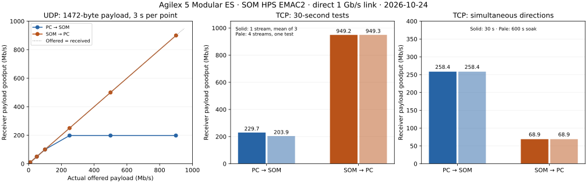

# SOM Ethernet hardware validation

The Agilex 5 Modular ES SOM exchanged real UDP and TCP packets with a directly
connected Linux PC on 24 October 2026. The complete campaign passed all 40
measurement cases, including a 600-second simultaneous TCP soak, and restored
DDR Hello and the peer NIC address. This extends the earlier PHY-ID check.

## Measured receiver payload goodput

All rates below are application payload Mb/s, not Ethernet wire rate. The
link negotiated 1000 Mb/s full duplex. CPU RAM was cached; DMA memory stayed
normal noncacheable. The benchmark uses copied buffers and software checksums.

| Test | PC → SOM | SOM → PC | Duration / repetition |
|---|---:|---:|---|
| Conservative UDP, no measured loss | 80.00 (80.00–80.00) | 720.02 (720.02–720.02) | Three 30-second runs each |
| Single-stream TCP | 229.68 (229.52–229.77) | 949.20 (949.09–949.25) | Three 30-second runs each |
| Four-stream TCP, aggregate | 203.94 | 949.34 | One 30-second run each |
| Simultaneous TCP, one stream each way | 258.40 | 68.93 | 30 seconds |
| Simultaneous TCP soak | 258.39 | 68.92 | 600 seconds |

Repeated rows show mean (minimum–maximum). The soak delivered
24,548,834,416 verified bytes across both directions. Parallel tests are
aggregate goodput, rather than an additional per-stream rate.

The 1472-byte UDP sweep requested 1, 10, 50, 100, 250, 500 and 900 Mb/s in each
direction for three seconds per step. PC-to-SOM receive saturated near 198 Mb/s
and lost packets at the higher offered rates. The highest zero-loss step tested
was 100 Mb/s; the conservative sustained setting was 80 Mb/s. Intermediate
rates between 100 and 250 Mb/s were not characterized. SOM-to-PC delivered
about 900 Mb/s with zero measured loss in the short sweep; the repeated
30-second tests used 720 Mb/s. The short sweep does not qualify sustained
900 Mb/s operation. All five payload sizes (64–1472 bytes) also passed at
10 Mb/s. Requested and actual offered rates are recorded separately.

## Functional and recovery checks

- Fresh DDR initialization: all four 64 MiB patterns and payload readback passed.
- CPU/DMA translation probes verified the selected memory attributes.
- PHY identified as Marvell 88E1512 and negotiated 1 Gb/s full duplex.
- ARP/ping and independent 400 MHz counter calibration passed.
- Exact UDP echoes passed at 64, 256, 512, 1024 and 1472 bytes.
- Deliberate duplicates, reordered sequences and one corrupt UDP payload were
  classified correctly. That intentional bad payload is expected in the smoke
  check; all normal benchmark payloads were valid.
- TCP received and produced verified patterns in single, parallel and
  simultaneous connections. Receiver byte counts matched sender counts for
  traffic into the SOM.
- Final restoration repeated the DDR checks and confirmed a live PC in DDR
  Hello. The runner removed its temporary `192.168.50.1/24` address. The existing
  Wi-Fi/default route and unrelated Atum board were left in place.

## Bring-up failures and fixes

The [attempt history](https://github.com/AEW2015/baremetal-drivers/blob/main/examples/agilex5-modular/validation/ethernet/attempts) retains failures as well as passing runs.
With the original PHY page-2/register-21 value `0x1076`, board ARP transmission
reached the peer while board RX reported CRC errors. Clearing only the extra RX
delay (`0x1056`) allowed small exchanges but failed at larger UDP payloads.
Clearing both extra delay bits (`0x1046`) passed the packet tests. The firmware
retains and restores the original volatile setting. This is a result for this
PCB/handoff, not a timing prescription for every Modular kit.

The first cached campaign passed single-stream receive but timed out at four
streams. The revised configuration uses 256 pool buffers, bounds TCP out-of-order
buffering to 16 pbufs per connection, and allows ten seconds for a socket stall.
Both short and 30-second four-stream hardware tests then passed. Those changes
were made together; the evidence does not isolate one as the sole cause.
Resource counters remain in the JSON. `sys_check_timeouts()` already includes
lwIP's out-of-order reclamation check.

A separate localhost negative test exposed delayed cancellation when a later
TCP worker failed. The host now consumes completed futures immediately and
shuts down its own sockets. The regression first failed after 5.00 seconds,
then all four Ethernet peer tests passed in under one second. These are host
failure tests, distinct from physical-board traffic results.

The initial uncached quick campaign recorded about 23.36 Mb/s TCP into the SOM
and 24.33 Mb/s out. Its five-second samples and earlier queue configuration make
it a historical baseline, not a controlled cache-only comparison.

## Configuration, source and evidence

The board is the established Modular ES `A5ED065BB32AE6SR0`, using SOM HPS EMAC2,
Marvell PHY address 0, MTU 1500 and A55.0 at EL3 with a polling lwIP stack. It uses
the matching custom SOF/handoff, not the Premium-kit image. HPS DDR bank 3A has
8 GiB; the bootstrap checks 64 MiB and still reports its configured-2-GiB versus
detected-8-GiB warning. This campaign does not qualify the whole DDR bank.

Tools were Arm GNU 13.2.Rel1 (GCC 13.2.1), Quartus 26.1.1, the existing
ADIv6 OpenOCD and pinned lwIP 2.2.1 commit
`77dcd25a72509eb83f72b033d219b1d40cd8eb95`. CPU and DMA layout is documented in
the [lab tutorial](examples/ethernet.md).

The full campaign used the host sources in commit `5077adf` and ELF SHA-256
`3656c3b19d6341c9a683710a48290e9f22b75da7be9275f4fa2af1e71f76c068`.
Subsequent commits add metadata capture and prompt host failure cancellation;
they leave firmware sources unchanged. A follow-up hardware stress run checks
that updated runner separately: [results](https://github.com/AEW2015/baremetal-drivers/blob/main/examples/agilex5-modular/validation/ethernet/attempts/ethernet-20261024T160302.077834Z/results.json).
It passed, archived the matching ELF, observed the original PHY value `0x1076`
at startup, and restored DDR Hello and the NIC address. GitHub CI builds both cache modes, runs the
34-test regression suite plus QEMU/fabric checks, and builds/deploys the tutorial.
CI builds do not constitute hardware execution.

- [Full run results](https://github.com/AEW2015/baremetal-drivers/blob/main/examples/agilex5-modular/validation/ethernet/attempts/ethernet-20261024T154231.864079Z/results.json)
- [Per-measurement JSON](https://github.com/AEW2015/baremetal-drivers/blob/main/examples/agilex5-modular/validation/ethernet/attempts/ethernet-20261024T154231.864079Z/bandwidth.json) and
  [CSV](https://github.com/AEW2015/baremetal-drivers/blob/main/examples/agilex5-modular/validation/ethernet/attempts/ethernet-20261024T154231.864079Z/bandwidth.csv)
- [Fresh UART](https://github.com/AEW2015/baremetal-drivers/blob/main/examples/agilex5-modular/validation/ethernet/attempts/ethernet-20261024T154231.864079Z/server-uart.txt), bootstrap and restore
  logs in that same directory
- [Build/source hashes](https://github.com/AEW2015/baremetal-drivers/blob/main/examples/agilex5-modular/validation/ethernet/network-final.json),
  [remote source check](https://github.com/AEW2015/baremetal-drivers/blob/main/examples/agilex5-modular/validation/ethernet/remote-source-check.json), and
  [capture/verification manifest](https://github.com/AEW2015/baremetal-drivers/blob/main/examples/agilex5-modular/validation/ethernet/manifest.json)
- [Bring-up packet capture](https://github.com/AEW2015/baremetal-drivers/blob/main/examples/agilex5-modular/validation/ethernet/bringup.pcap.gz): 662 ARP/IPv4 packets from
  functional bring-up, captured before the bandwidth campaign; no soak trace
- [Host regression evidence](https://github.com/AEW2015/baremetal-drivers/blob/main/examples/agilex5-modular/validation/ethernet/regression-final.log) and
  [before/after cancellation regression](https://github.com/AEW2015/baremetal-drivers/blob/main/examples/agilex5-modular/validation/ethernet/bidir-regression-before.log)

The protocol is custom; iperf2/iperf3 clients cannot drive these endpoints. Host
TCP retransmission counts describe only the PC sender. TCP timing begins after
connection establishment; small amounts of prebuffered source data can affect
short tests. These socket-level measurements are not on-wire timestamps.
This result covers one
board, handoff, peer and bench session; it does not establish coherent
DMA, zero-copy performance, interrupt-driven networking, other link speeds or
production network robustness. No flash, SD, EEPROM-array or clock-NVM writes
were part of the campaign.
