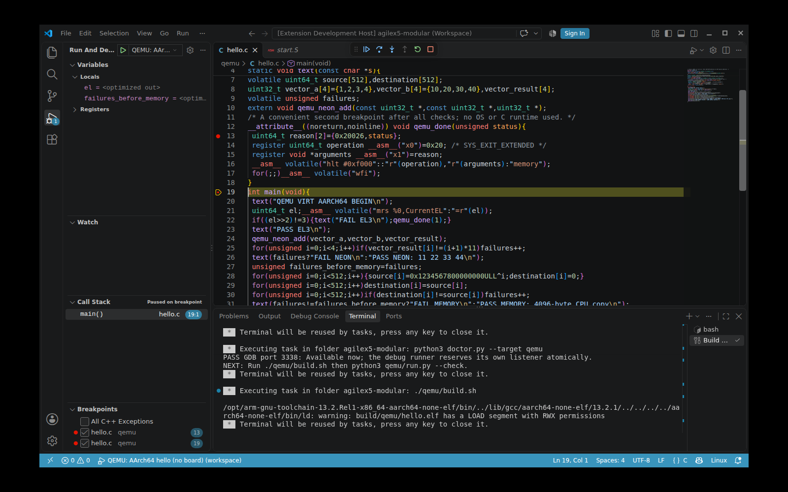
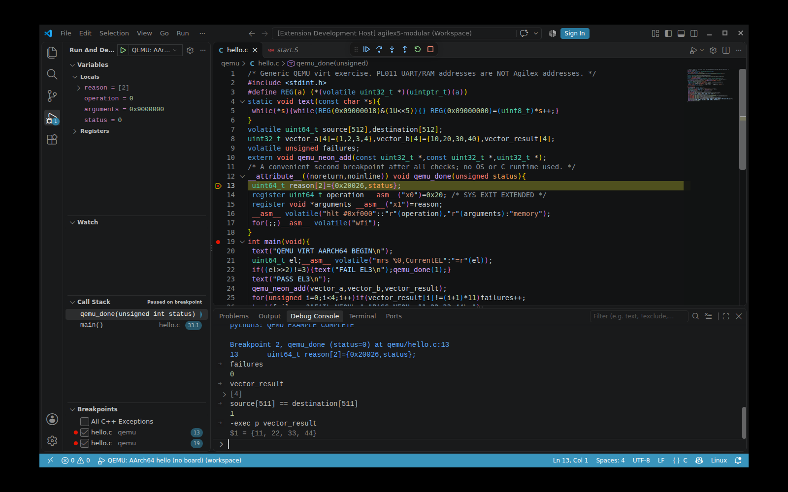
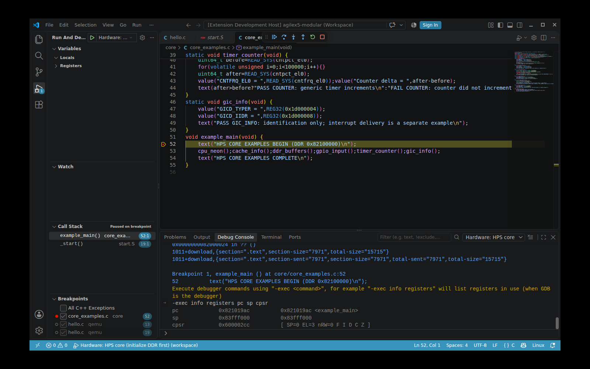

# Onboarding and desktop feedback follow-up

The supplied walkthrough feedback correctly separated an established bench from
an independent new-kit experience. We applied it as implementation work and
performed the checks below. These are agent-operated technical trials, not a
usability study with real students.

## What changed

| Feedback | Change | Evidence / remaining limit |
|---|---|---|
| Private container prevents recreation | Public-source Ubuntu learning and Quartus-based hardware [recipe](container.md), pinned Arm archive checksum, explicit source/USB/license inputs | Both images built; fresh-container clone/build/QEMU passed. New image's physical USB/JTAG path was not exercised |
| Matching FPGA image is unexplained | [Artifact onboarding](fpga-design.md), exact upstream commit/design, source-reviewed build stages, known bench profile and SOF/handoff identity gate | Recorded pair matches; altered pairs fail. Complete custom integration is still not packaged; fresh-kit qualification remains open |
| F5 was unverified | Actual Linux VS Code GUI tests for QEMU and hardware, stop/relaunch, screenshots; hardware architecture/ELF setup corrected | Tested inside the existing container under Xvfb; separate Dev Containers attachment flow is not covered |
| QEMU route gets lost in board setup | Hardware build section explicitly marked **Hardware track only**; direct QEMU-to-VS-Code link retained | No-board students need no Quartus, board images or full vendor build |
| PASS does not teach startup | EL3, stack, BSS, MMIO and semihosting explanations plus prediction/mismatch/correction exercise | Executed isolated exercise prints BASELINE, MISMATCH and CORRECTED |
| Host/container switching is hard to track | [Persistent diagram/table](container.md#persistent-hostcontainer-map); existing doctor now optionally checks source SOF/handoff identity too | Mount, tools, UART and JTAG checks remain read-only; they do not certify an unknown FPGA build |

The expanded Python regression suite passed **29 tests**, including real QEMU
positive/negative checks and artifact-pair rejection cases.

## Clean-container trial

A new learning image was built from the public Ubuntu base and repository recipe,
without the existing bench filesystem or tool installation as an input. In an
ephemeral container, a clean public clone passed doctor, the pinned compiler
build and QEMU's required markers/exit status. The teaching exercise also passed
in that image with its lesson source mounted read-only. The hardware image was
built from the pinned public Quartus base; compiler, GDB, Quartus and OpenOCD
versions were checked without connecting that new container to USB.

This is a clean **container** trial on the existing Linux host. It is not an
independent human trial, a new physical PC installation or a new Modular kit.
See the [captured manifest and logs](https://github.com/AEW2015/baremetal-drivers/tree/main/examples/agilex5-modular/validation/onboarding).

## Actual desktop debug trial

Tools: VS Code **1.143.1**, C/C++ **1.34.4**, Arm GNU **13.2.Rel1**, GDB **15.1**,
QEMU **8.2.2**, Quartus OpenOCD **0.12.0+quartus-gc58ca4ebc**. The actual Linux
Electron application rendered on an isolated Xvfb desktop inside `agilex-xrdp`.
Keyboard/mouse actions launched the supplied workspace configurations. A small
local validation extension recorded debugger events/evaluations; this explains
the **Extension Development Host** title in the unedited screenshots.

The QEMU first remote stop is `_start`, not `main`. Continuing to a managed
source breakpoint reaches `main`; continuing again reaches `qemu_done` with
`status=0`, `failures=0`, vector `{11,22,33,44}` and matching copied words.
Stop Debugging released the port; a fresh launch reached startup again.

On the physical Modular ES kit, the hardware configuration loaded the ELF,
started at its entry and reached the managed `example_main` source breakpoint.
The Debug Console showed PC `0x821019ac`, SP `0x83fff000` and EL3 state. After
continue, host UART capture contained all required core markers and COMPLETE.
A second session, after fresh DDR initialization, reached the same breakpoint,
stepped to the next source line, continued and completed again. Stop released
OpenOCD's ports and the shared lock. DDR Hello was restored with fresh patterns,
payload readback and PC proof after the hardware trials.

### Failures the GUI trial uncovered

The old hardware configuration relied on implicit architecture and ELF setup.
The desktop adapter reported an invalid `arch`, then “No executable file
specified” at target download. The workspace now declares ARM64, sets GDB to
AArch64 and explicitly selects the ELF before download. Source breakpoints are
managed by VS Code, rather than inserted behind the adapter's back as raw MI
breakpoints. QEMU instructions now describe the observed `_start` stop.

An immediate bootstrap issued before Shift+F5 had finished cleanup was correctly
rejected as busy. Waiting for session termination and checking the lock/ports
allowed the next bootstrap. That rejected attempt is retained in the evidence;
no lockfile was deleted and no competing programmer was started.

## Still open before independent hardware onboarding

An instructor must supply the complete qualified custom FPGA project/artifact
package or qualify a rebuilt public reference on the student's exact board.
The public upstream source alone does not reproduce the custom bench SOF.
Native Windows/macOS, the Dev Containers attach UI, new-image USB permissions,
new FPGA fabric integration and live partial reconfiguration remain outside
this desktop check. The next human trial should record every instructor-supplied
input and intervention, using the exact software/image revisions in its report.

## Additional execution feedback: independent failure checks

A supplied student report describes successful QEMU output, CLI GDB inspection,
full example compilation, all 15 registered hardware-suite builds and OCRAM
ELF/binary/HEX generation. The reporter did not execute hardware or test the
VS Code GUI; those limits apply to that report and are separate from the
bench desktop/hardware evidence above. Its source revision was not supplied.
The linked `/home/Workspace/baremetal-student-audit/` files are unavailable in
this workspace, so their raw transcripts and JSON have not been independently
inspected or incorporated as local execution evidence.

The reported misleading `FAIL MEMORY` after only NEON corruption is already
fixed in the current hello source: the memory check compares the failure count
before and after copying. A fresh local replay now exercises both a vector-result
bit flip and a final-word-only copy corruption. Each reports exactly its own
failed check and guest/runner exit 1. Restoring the original source gives exit 0.
The [optional failure-and-recovery exercise](qemu.md#predict-modify-explain)
shows the actual output, expected statuses and distinction between a deliberately
failed guest and a successfully completed experiment script.

The setup, QEMU and troubleshooting pages now explain the expected RWX linker
warning next to the build instructions. A fresh pinned-toolchain build returned
zero; `readelf -lW` confirmed one `RWE` load segment containing `.text`, `.data`
and `.bss`. It remains a minimal teaching layout, not a production protection
configuration.

Fresh replay evidence is in
[validation/student-feedback](https://github.com/AEW2015/baremetal-drivers/tree/main/examples/agilex5-modular/validation/student-feedback):
all six experiment stages, the linker warning/program headers, source hashes
and the regression test transcript. No new physical-board run is claimed for
this documentation and emulator follow-up.

The first CI replay of the extended exercise exposed a checker mistake: it
searched the runner's combined output and mistook a diagnostic listing a missing
PASS marker for an actual PASS. The checker now checks guest stdout lines for
contradictions and keeps stderr for exit diagnostics. That rejected attempt is
retained as `checker-first-attempt.log`; the final local replay passes all stages.
