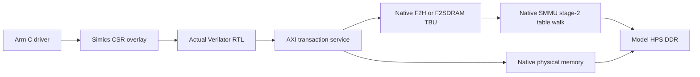

# Arm driver → actual RTL → Simics DDR

This adapter connects the bare-metal C driver in `../driver.c` to the actual
`../rtl/ddr_probe.sv` compiled by Verilator. The RTL's AXI initiator emits memory
transactions that Python services through a **native Simics memory-space
interface**. Python does not implement the DDR test pattern, RAM storage,
translation tables or page permissions.

The direct route uses the model's `hps.phys_mem`. The two translated routes
use the actual native F2H and F2SDRAM TBU memory-space interfaces. Both native
routes have passed nonidentity stage-2 transfers and deliberate unmapped-access
faults with actual RTL bus traffic. These are model functional results; they do
not qualify a physical FPGA bridge, hardware SMMU setup or continuous-cycle
HPS/RTL timing.

| Exercise | Recorded result |
|---|---|
| Direct DDR, 64 writes + 64 reads and CPU readback | Passed |
| Explicit AXI response-error injection | Passed; driver recognizes error |
| Explicit final-read data corruption | Passed; RTL reports index 63 mismatch, native RAM unchanged |
| AW stall, watchdog timeout and safe transaction drain | Passed |
| Native F2H TBU4, valid stage-2 mapping | Passed |
| Native F2H TBU4, unmapped fault | Passed; native S2 fault record and unchanged guards |
| Native F2SDRAM TBU5, valid stage-2 mapping | Passed |
| Native F2SDRAM TBU5, unmapped fault | Passed; native S2 fault record and unchanged guards |

The [final result index](validation/results.json) links all eight selected
results. Earlier failed and superseded attempts remain under `validation/`.



## Transaction workflow

1. An actual AArch64 guest executes `ddr_probe_run()` through volatile MMIO at
   `0x20030000`.
2. A 256-byte Simics I/O-memory overlay forwards each 32-bit CSR read/write to
   the Verilator child over a bounded line protocol.
3. The child clocks the actual SystemVerilog. It handshakes separate AXI AW,
   W, B, AR and R channels, enforcing the implemented single-beat 64-bit shape.
4. A memory request pauses the RTL clock while Python calls the native memory
   space. The returned data or error becomes AXI RDATA/RRESP or BRESP.
5. The RTL checks data itself and sets its status registers. The guest C driver
   checks completion, and the CPU independently verifies every resulting word.

This is transaction stepping. Python service time is not modeled as physical
AXI latency, and clocks do not run continuously while waiting on the pipe.
There is no Questa backend in this adapter.

The RTL guard permits bus addresses only in `[0x85000000, 0x85010000)`.
The positive exercise writes/reads 64 words, seed `0x12345678`, and then verifies
that a driver request outside the guard is rejected. The host requires exactly
64 AXI writes and 64 AXI reads at the expected addresses, matching full data
patterns, native successful completions, and CSR requests originating from
Arm core 0. CSR ID reads alone cannot pass the exercise.

## Build and run

From `examples/agilex5-modular` inside the configured tool container:

```sh
bash memory-labs/fabric-ddr/simics/build.sh
python3 memory-labs/fabric-ddr/simics/run.py
python3 memory-labs/fabric-ddr/simics/run.py --case axi-error
python3 memory-labs/fabric-ddr/simics/run.py --case read-error
python3 memory-labs/fabric-ddr/simics/run.py --case timeout-drain
python3 memory-labs/fabric-ddr/simics/run.py --route f2soc --case native-valid
python3 memory-labs/fabric-ddr/simics/run.py --route f2soc --case native-fault
python3 memory-labs/fabric-ddr/simics/run.py --route f2sdram --case native-valid
python3 memory-labs/fabric-ddr/simics/run.py --route f2sdram --case native-fault
```

The build uses the existing Arm compiler, Verilator and lab startup/runtime.
Ignored outputs are in `build/fabric-ddr-simics/`; `build.json` binds exact source
and artifact hashes. The runner reuses the configured Simics 26.3 project and
OCRAM DDR bootstrap, verifies all build identities, requires DDR self-test
completion, loads the guest, records UART and JSON-lines transactions, and
closes/reaps its child backend. It owns no physical-board devices or bench lock.

## Debugging evidence

The initial capture `validation/physical-initial/` is retained. It performed
64 successful native writes and returned the correct first read, but the
adapter incorrectly treated integer zero as Simics's no-exception code.
The installed Simics API uses `Sim_PE_No_Exception` (value 1025), so this
incorrectly generated AXI DECERR on that read. The corrected adapter compares
the named enum and records both its raw value and the successful-completion
predicate. This initial adapter failure is not a physical DDR or RTL failure.

## Native TBU translation and fault evidence

The translated backend is separately compiled with actual RTL `AXPROT=010`
(nonsecure, unprivileged data). The protocol carries each actual AW/AR PROT and
USER value, and the adapter requires PROT=2 and USER=0 for native routes. The
shared [native fixture](../../smmu/native_fixture.py) creates matching native
transaction attributes and issues them through `f2soc_smmu_mem_space` (TBU4)
or `f2sdram_smmu_mem_space` (TBU5). It supplies **no SID atom**: the model's
fabric ingress default SID0 is independently verified in the fault record.
Physical AXUSER-to-SID wiring is not qualified. Direct/injection profiles use
the separate PROT=0 RTL build. Unsupported attributes, bursts, IDs, widths and
strobes are rejected rather than silently discarded.

The fixture programs real model stage-2 tables at `0x85400000` and maps bus
IOVA `0x85000000` to physical `0x86000000`. The translated positive case
requires 64 actual RTL writes and reads, RTL verification, independent CPU
readback at the different physical address, and an unchanged 64-word guard at
the physical IOVA address. That guard detects accidental identity/bypass access.

Each fault case starts in a separate fresh model session, removes the 2 MiB
mapping before the guest requests `0x85002000`, and requires all of:

- C driver bus-error result and RTL error-address match.
- One actual failed native transaction, with no Python response injection.
- Native event-queue producer 1, translation-fault type `0x10`, SID0, stage-2
  flag and matching fault IOVA; no global SMMU error.
- Unchanged 64-word physical-IOVA and translated-target guards.
- Native CR0 cleared during cleanup.

The model's TLB cache is disabled. These tests establish **fresh table-walk**
behavior; they do not establish command-queue consumption, CR0ACK completion,
TLBI or cached-translation invalidation. CR0ACK reads zero in the tested model;
no ACK/consumer register is forced to claim completion.

## Deliberate failures

`axi-error` overrides a successful native physical write's response with
DECERR. `read-error` flips bit 0 of only the last delivered read value; the
native memory remains correct. These are explicit adapter injections, not
native SMMU faults.

`timeout-drain` holds AWREADY low until backend cycle 1600. The actual RTL
watchdog flags timeout while AWVALID remains pending. The C driver must then
drain the accepted transfer; the test requires exactly one completed native
write, no reads, zero verified words and an idle final status with timeout
retained. It does not cancel an outstanding AXI transfer on timeout.


### Native F2H valid mapping — captured UART

```text
FABRIC_DDR_DRIVER_RC=0x0000000000000000
FABRIC_DDR_VERIFIED=0x0000000000000040
PASS FABRIC_DDR_CPU_READBACK
LAB COMPLETE
```

### Native F2H unmapped access — captured UART

```text
FABRIC_DDR_DRIVER_RC=0xfffffffffffffffb
FABRIC_DDR_ERROR=0x0000000000000003
FABRIC_DDR_FAIL_ADDRESS=0x0000000085002000
PASS FABRIC_DDR_EXPECTED_AXI_FAULT
LAB COMPLETE
```

### Timeout followed by drain — captured UART

```text
PASS FABRIC_DDR_EXPECTED_TIMEOUT_BUSY
PASS FABRIC_DDR_TIMEOUT_DRAINED
PASS FABRIC_DDR_TIMEOUT_STOPPED_AFTER_DRAIN
PASS FABRIC_DDR_DRAINED_WRITE_COMPLETED
```
