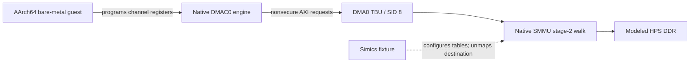

# Real DMAC0 engine through the native Agilex SMMU model

This bare-metal guest programs the **native DMAC0 controller model**, rather
than asking Python to issue memory transactions on its behalf. The native
Agilex Simics run passed a nonidentity-mapped 4096-byte copy and then the
expected stage-2 destination translation fault. The guest verifies every word;
the host independently checks physical RAM, untouched raw-address aliases and
the native SMMU event.

This is a **Simics-only model qualification**. The host prepares the native
SMMU fixture and removes its destination PTE between phases. Physical hardware
has not been ported or run, and command-queue/TLBI behavior is not qualified.
QEMU's separate EDU example in the parent directory is a different initiator.



## Build and run

From `examples/agilex5-modular` inside the configured compiler/Simics container:

```sh
bash memory-labs/smmu/dmac/build.sh
python3 memory-labs/smmu/dmac/run_simics.py
```

The builder uses `legacy_source.py` to fetch/check immutable commit
`1419101568f1a9034630b632634fe9fe71773266` for `dma_regs_t`, `dma_lli_t` and the
address definitions. This new register-level guest is not a qualification of
the rewritten 26.3 high-level DMA driver. Compiler, source/header hashes and
ELF/binary identities are recorded in `build/memory-smmu-dmac/build.json`.

The runner uses the deployed native project `build/simics26` and pinned OCRAM
bootstrap `build/upstream26-ocram/baremetal.bin`. Each process must complete
`ddr_selftest` before loading the guest at `0x82400000`. A 180-host-second bound
covers the complete experiment. It requires the guest success markers **and**
the independent native fixture results; a process returning zero is not enough.

[Final execution evidence](validation/simics-final/results.json),
[guest UART](validation/simics-final/uart.txt) and
[native observations](validation/simics-final/native.json) preserve the tested
scope. The earlier [initial run](validation/simics-initial/results.json) is
retained; the final guest additionally checks configuration-register readbacks
during cleanup.

## Addresses and phases

The fixture uses three 2 MiB stage-2 blocks, but data checks cover 4096 bytes.
The CPU accesses physical RAM with its MMU/data cache off; DMA address fields
contain the distinct IOVAs below.

| Purpose | DMA IOVA | CPU physical RAM |
|---|---|---|
| Source data | `0x85000000` | `0x86000000` |
| Destination data | `0x85200000` | `0x86200000` |
| Linked-list descriptor | `0x85600000` | `0x86400000` |
| Stage-2/stream tables and event queue | — | `0x85400000` onward |
| Uncached CPU/host phase flags | — | `0x86600000` |

The fixture sets the DMA0 read/write stream IDs to 8 in System Manager register
`0x10d121a8` and selects the native path using `0x10d1217c=3`. It does not insert
a synthetic SID into a host-issued DMA transaction: the event's actual SID
provides the observed route check.

1. The guest fills source PA with a deterministic pattern and destination PA
   with zero. It fills 4096-byte guards at **each raw IOVA numerical address**.
   Those CPU physical guard areas must remain untouched; they detect a
   controller bypassing the intended nonidentity translation.
2. The guest programs channel 0 with source/destination/descriptor IOVAs and
   starts the actual DMAC0 engine. It requires transfer-complete status, all
   512 destination words, unchanged alias guards and no SMMU event.
3. The host stops at the guest's phase-complete marker, independently verifies
   those data/guards, removes only the destination PTE, then sets the guest's
   uncached phase flag. The source and descriptor mappings remain valid.
4. The guest changes the source pattern and starts DMAC0 again. It requires
   no false transfer-complete status, a quiescent channel, a native stage-2
   translation event for SID 8/address `0x85200000`, and all 4096 destination
   bytes still holding the first pattern. All raw IOVA guards must also remain
   unchanged. The host independently repeats these checks.

No host helper calls `NativeTBUFixture.transaction()` or a Python ingress
transaction API. Python writes only fixture configuration/PTEs and the phase
flag, and reads observations. The C guest starts the controller in both phases.

## AXI protection fields: an important register distinction

The channel's **CTL**, not CFG2, controls the AXI protection attributes:

| Register field | Location | Value used |
|---|---|---|
| `CH_CTL.AR_PROT` | `[34:32]` | `2`, nonsecure unprivileged data |
| `CH_CTL.AW_PROT` | `[37:35]` | `2`, nonsecure unprivileged data |
| `CH_CFG2.TT_FC` | `[34:32]` | `0`, memory-to-memory flow control |

Both the initial channel CTL and the linked descriptor carry the protection
fields. Treating CFG2 bits 32–34 as a security field would instead change the
transfer type. The field positions are documented by the
[Agilex 5 R0 register map](https://docs.altera.com/v/u/resources/864456/agilex-5-r0-suffix-opn-hps-register-map)
and the repository's current `drivers/dma/socfpga_dma_reg.h`. The HPS TRM's
initiator-security table identifies AXI `A*PROT[1]=1` as nonsecure for DMA.

## Actual terminal output

The final successful native-model run records:

```text
DMAC_SAR_IOVA=0x0000000085000000
DMAC_DAR_IOVA=0x0000000085200000
DMAC_LLP_IOVA=0x0000000085600000
DMAC_CTL=0xc000001240001b00
DMAC_CHANNEL_STATUS=0x000000000000001b
PASS DMAC_TRANSLATED_TRANSFER_DONE
PASS DMAC_RAW_IOVA_ALIASES_UNCHANGED
PASS DMAC_VALID_TRANSFER_NO_SMMU_EVENT
PASS DMAC_SMMU_COPY_4096_NATIVE_ENGINE
```

After the host removes the destination mapping:

```text
DMAC_CHANNEL_STATUS=0x0000000080000148
DMAC_CHANNEL_ENABLE=0x0000000000000000
PASS DMAC_UNMAPPED_NO_FALSE_DONE
PASS DMAC_FAULT_CHANNEL_QUIESCENT
PASS DMAC_FAULT_IOVA_GUARDS_UNCHANGED
DMAC_SMMU_EVENT0=0x0000000800008010
DMAC_SMMU_EVENT1=0x0000018000000000
DMAC_SMMU_FAULT_IOVA=0x0000000085200000
PASS DMAC_NATIVE_S2_TRANSLATION_FAULT_SID8
DMAC_FINAL_CHEN=0x0000000000000000
PASS DMAC_REGISTERS_CLEANED_UP
PASS DMAC_SMMU_FAULT_GUARD_4096_NATIVE_ENGINE
```

The controller model reported error/abort status and cleared channel enable;
the million-iteration polling bound was not exhausted. The guest nevertheless
has bounded abort/disable cleanup for a channel that remains active. Cleanup
clears current interrupt status, restores saved configuration/channel fields
and requires their readbacks to match. Interrupt delivery is not tested.

## Model limits and a hardware port

`NativeTBUFixture` explicitly requires `tlb_cache_enable=False`. PTE removal
therefore tests a fresh native table walk, **not architectural invalidation**.
The observed `CR0ACK=0` is retained in evidence; the test never fabricates an
acknowledgement or command-queue completion. The fixture disables translation
and restores the prior System Manager route fields at the end.

A physical port needs a real CPU-driven SMMU initialization/invalidation
driver, architectural enable/queue acknowledgements, verified stream/security
routing, owned DDR scratch, DMA cache maintenance where applicable, and the
existing shared hardware mutex plus recovery path. The Simics `HRESET` model
signal and host PTE edits are not a physical deployment recipe. No physical
DMA bandwidth, full SMMU feature coverage or production-driver result is claimed.
